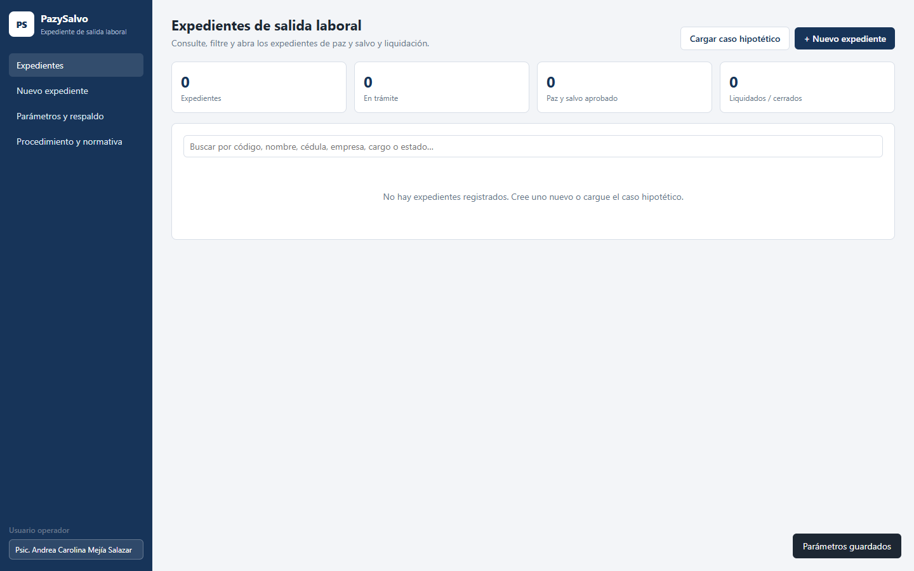
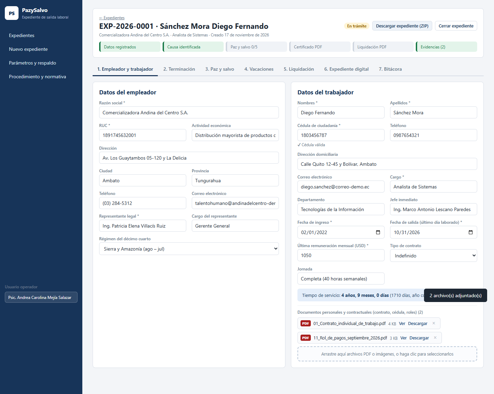
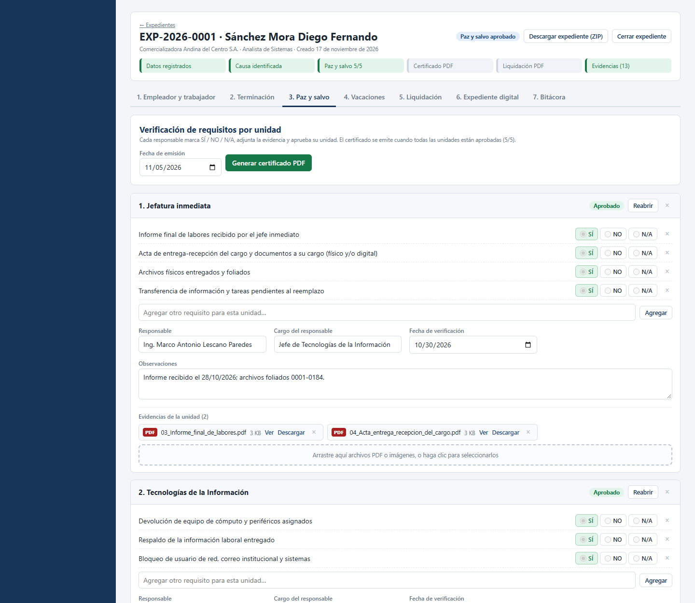
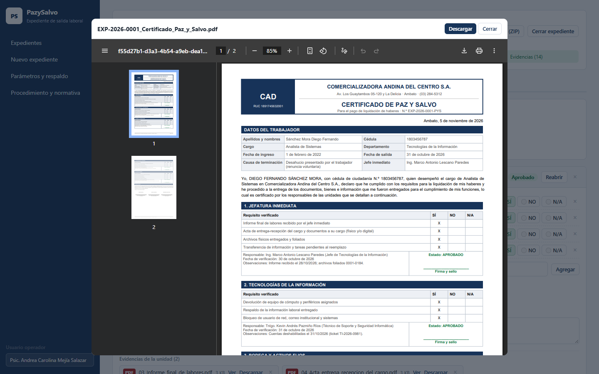
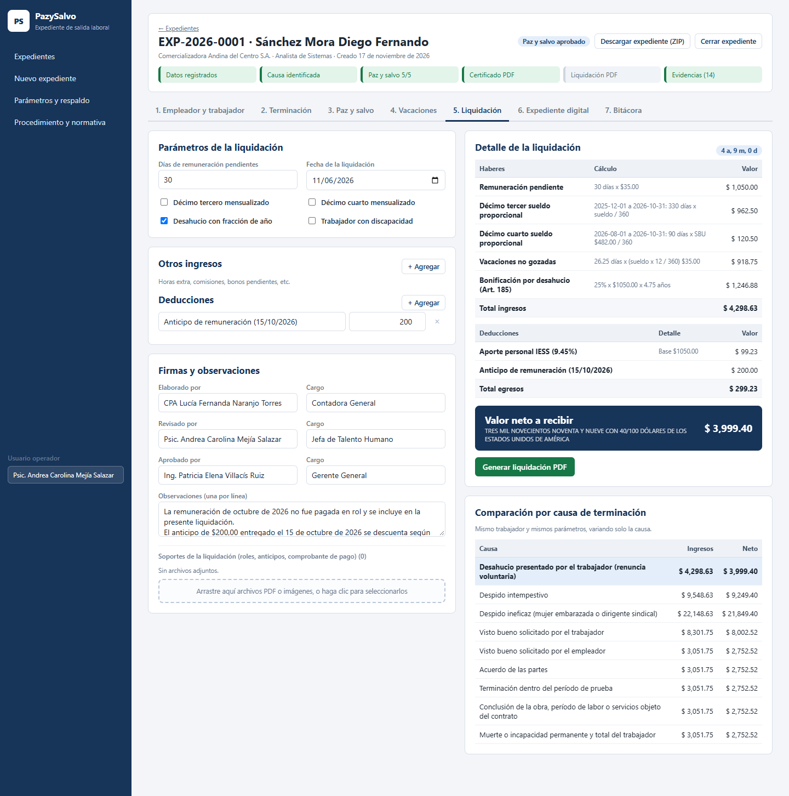
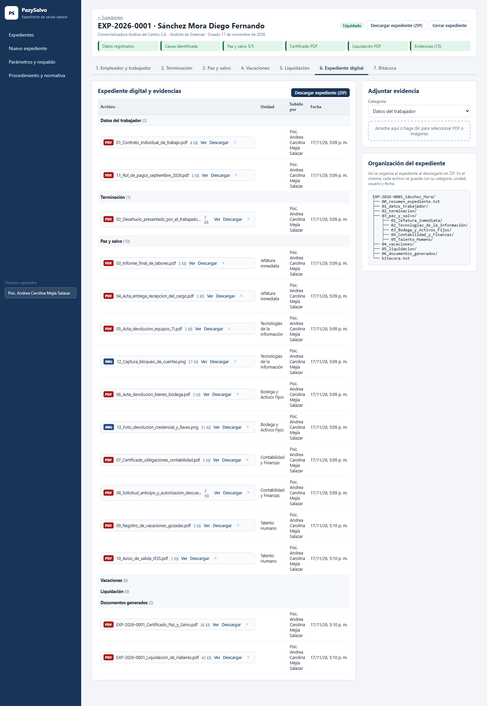
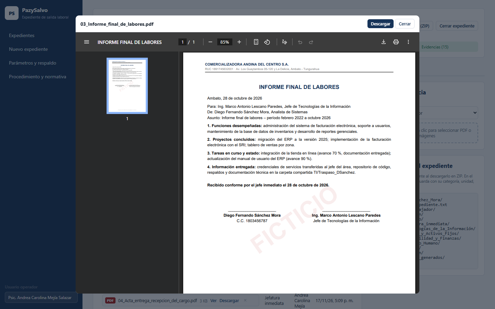
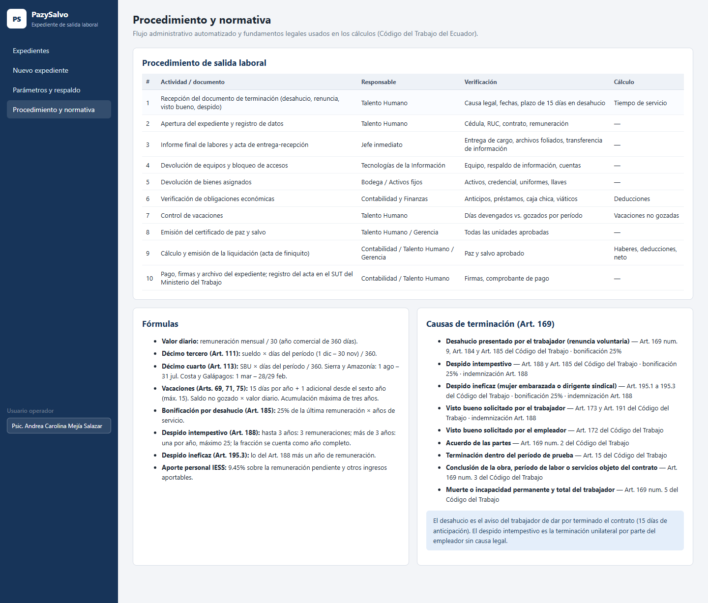
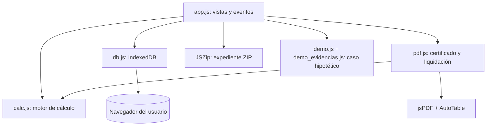

# 📋 PazySalvo: paz y salvo y liquidación laboral

[](https://developer.mozilla.org/es/docs/Web/HTML)
[](https://developer.mozilla.org/es/docs/Web/JavaScript)
[](https://developer.mozilla.org/es/docs/Web/API/IndexedDB_API)
[](https://github.com/parallax/jsPDF)
[](https://developers.cloudflare.com/cloudflare-one/connections/connect-networks/)
[](LICENSE)

**PazySalvo** es una aplicación web que automatiza el trámite de salida de un trabajador en Ecuador: arma el expediente, recoge el paz y salvo de cada unidad de la empresa con sus evidencias y calcula la liquidación de haberes según el Código del Trabajo. Está pensada para el área de talento humano de una empresa pequeña o mediana.

Se hizo como práctica de la Guía APE 4, que pide automatizar el paz y salvo y la liquidación laboral. No tiene backend ni base de datos en un servidor: todo corre en el navegador y los datos se guardan en el equipo de quien la usa.

> [!TIP]
> **¿Quieres verla funcionando?** Abre la demo en [pazysalvo.madebyjohan.xyz](https://pazysalvo.madebyjohan.xyz) y, en **Expedientes**, pulsa **Cargar caso hipotético completo**. Para usarla sin Internet, descarga el repositorio y abre `app/index.html` (o `abrir_app.bat` en Windows) en Chrome o Edge.

---

## 🛡️ Descripción

### ¿Qué problema resuelve?
Cuando un trabajador sale de una empresa, talento humano tiene que perseguir firmas de varias unidades (jefatura, sistemas, bodega, contabilidad), juntar actas y comprobantes sueltos y calcular a mano los décimos, las vacaciones y las bonificaciones que dependen de la causa de salida. Es fácil olvidar un requisito o aplicar mal una fórmula. **PazySalvo** ordena el trámite en pasos, no deja emitir la liquidación hasta que todas las unidades aprueben y hace el cálculo citando el artículo de cada rubro.

### ¿Qué hace?
1. Registra los datos del empleador y del trabajador, y valida la cédula con el dígito verificador.
2. Registra la causa de terminación (nueve causas del Código del Trabajo) y su base legal.
3. Pide el paz y salvo a cinco unidades: Jefatura inmediata, Tecnologías de la Información, Bodega y Activos Fijos, Contabilidad y Finanzas, y Talento Humano. Cada una marca sus requisitos, adjunta evidencias y aprueba u observa.
4. Genera el **certificado de paz y salvo** en PDF. Si falta alguna aprobación, sale como BORRADOR.
5. Calcula las vacaciones pendientes por período y la **liquidación de haberes**, con una tabla que compara el neto según cada causa de terminación.
6. Genera la **liquidación en PDF**, con el valor en letras y las firmas.
7. Reúne todo en un **expediente digital** que se descarga en ZIP, y deja una bitácora con cada acción, su usuario y su fecha.

### ¿Para quién está pensado?
Para el área de talento humano o contabilidad que tramita salidas de personal, y para quien quiera estudiar cómo se calcula una liquidación laboral en Ecuador: el motor de cálculo es un archivo de funciones puras que se puede probar con Node.

---

## 📸 Capturas

| | |
|---|---|
| <br><sub>Listado de expedientes</sub> | <br><sub>Datos del empleador y del trabajador</sub> |
| <br><sub>Paz y salvo aprobado por las unidades</sub> | <br><sub>Certificado de paz y salvo en PDF</sub> |
| <br><sub>Liquidación y comparación por causa</sub> | <br><sub>Expediente digital</sub> |
| <br><sub>Visor de evidencias</sub> | <br><sub>Procedimiento y normativa</sub> |

Las capturas usan el caso hipotético; todos los datos son ficticios.

---

## ✨ Características

- **Flujo en siete pestañas**: empleador y trabajador, terminación, paz y salvo, vacaciones, liquidación, expediente digital y bitácora.
- **Paz y salvo por unidad**: cada unidad tiene su lista de requisitos SÍ/NO, su responsable y su fecha. Con un requisito en NO, el sistema exige observar en lugar de aprobar.
- **Evidencias adjuntas**: PDF e imágenes que se arrastran a cada pestaña o unidad, con visor integrado y registro de quién las subió.
- **Motor de liquidación**: remuneración pendiente, décimo tercero y décimo cuarto proporcionales, vacaciones no gozadas, bonificación por desahucio, indemnizaciones por despido y aporte personal al IESS.
- **Comparación por causa**: muestra cuánto recibiría el mismo trabajador con cada una de las nueve causas de terminación.
- **Documentos PDF**: certificado de paz y salvo y liquidación de haberes, con el valor neto en letras.
- **Expediente en ZIP**: descarga todos los documentos y evidencias ordenados en carpetas.
- **Parámetros editables**: salario básico unificado y tasa de aporte al IESS.
- **Respaldo**: exporta e importa todos los expedientes en un archivo `.json` para llevarlos a otro equipo.
- **Caso hipotético**: carga un expediente completo de ejemplo, o solo sus datos para hacer el paz y salvo en vivo.

---

## 🛠️ Tecnologías Utilizadas

- **Frontend**: HTML, CSS y JavaScript sin frameworks ni proceso de compilación.
- **Almacenamiento**: IndexedDB del navegador.
- **Documentos**: jsPDF 2.5.1, jsPDF AutoTable 3.8.2 y JSZip 3.10.1, incluidos en `app/vendor/` para funcionar sin Internet.
- **Caso de ejemplo**: Python con ReportLab para generar los documentos ficticios de respaldo.
- **Despliegue**: Caddy 2 en Docker, publicado con un túnel de Cloudflare.

---

## 🏗️ Arquitectura



Todo se ejecuta en el navegador. `calc.js` no depende del DOM, así que el mismo código que usa la interfaz se puede ejecutar en Node.

---

## 📁 Estructura del Proyecto

```bash
.
├── app/
│   ├── index.html                # Página única de la aplicación
│   ├── css/styles.css            # Estilos
│   ├── js/
│   │   ├── calc.js               # Motor de cálculo (funciones puras, usable en Node)
│   │   ├── db.js                 # Acceso a IndexedDB
│   │   ├── pdf.js                # Certificado de paz y salvo y liquidación en PDF
│   │   ├── app.js                # Vistas, flujo del expediente, ZIP y respaldo
│   │   ├── demo.js               # Plantillas de unidades y caso hipotético
│   │   └── demo_evidencias.js    # Evidencias del caso hipotético en base64
│   └── vendor/                   # jsPDF, jsPDF AutoTable y JSZip
├── caso_hipotetico/
│   ├── generar_documentos.py     # Genera los documentos ficticios con ReportLab
│   ├── documentos/               # 17 documentos de respaldo (14 PDF y 3 imágenes)
│   └── evidencias_demo/          # Los mismos documentos ordenados por pestaña
├── deploy/
│   ├── compose.yaml              # Contenedor Caddy para el homelab
│   └── Caddyfile                 # Servidor de archivos estáticos
├── docs/capturas/                # Capturas del README
├── abrir_app.bat                 # Abre la app en el navegador (Windows)
└── LICENSE
```

---

## 💻 Requisitos del Sistema

- Un navegador moderno con IndexedDB. Se probó en Chrome y Edge.
- Solo para regenerar los documentos del caso: Python 3 con `reportlab`.
- Solo para producción: Docker con Docker Compose y, si se publica con túnel, `cloudflared`.

---

## ⚙️ Instalación y Configuración

1. Clonar el repositorio:
   ```bash
   git clone https://github.com/kiramman-mp3/sistema-paz-y-salvo-laboral.git
   cd sistema-paz-y-salvo-laboral
   ```
2. Abrir `app/index.html` en el navegador. No hay dependencias que instalar ni variables de entorno.
3. En **Parámetros y respaldo**, revisar el salario básico unificado (por defecto USD 482) y la tasa de aporte personal al IESS (por defecto 9,45 %).

Los expedientes quedan en el navegador del equipo donde se registran. Para pasarlos a otro equipo, usar **Descargar respaldo (.json)** y luego **Restaurar respaldo**.

---

## 🚀 Uso y Ejecución

### Sin servidor
Abrir `app/index.html` o `abrir_app.bat`.

### Con un servidor local
```bash
npx serve app
```

### Scripts

| Comando | Qué hace |
|---|---|
| `python caso_hipotetico/generar_documentos.py` | Regenera los documentos ficticios del caso hipotético |
| `docker compose -f deploy/compose.yaml up -d` | Levanta el contenedor `pazysalvo-web` con Caddy |

---

## 🌐 Despliegue

La demo corre en un homelab con Docker. `deploy/compose.yaml` levanta Caddy sirviendo `app/` y lo conecta a la red externa `edge`, donde está el contenedor `cloudflared`. En Cloudflare, la ruta del túnel `pazysalvo.madebyjohan.xyz` apunta a `http://pazysalvo-web:80`.

```bash
docker network create edge   # solo si la red no existe
docker compose -f deploy/compose.yaml up -d
```

No hay variables de entorno: la app no guarda datos en el servidor. El token del túnel se configura en el contenedor de `cloudflared` y nunca se guarda en el repositorio.

---

## ⚖️ Reglas de cálculo

| Rubro | Fórmula | Base legal |
|---|---|---|
| Remuneración pendiente | sueldo / 30 × días pendientes | — |
| Décimo tercero | sueldo × días del período / 360 (1 dic – 30 nov) | Art. 111 |
| Décimo cuarto | SBU × días del período / 360 (Sierra y Amazonía: 1 ago – 31 jul; Costa y Galápagos: 1 mar – fin de feb) | Art. 113 |
| Vacaciones no gozadas | sueldo / 30 × días pendientes (hasta tres períodos acumulados) | Art. 69 y Art. 75 |
| Bonificación por desahucio | 25 % × última remuneración × años de servicio | Art. 185 |
| Despido intempestivo | 3 remuneraciones hasta 3 años; luego una por año, hasta 25 | Art. 188 |
| Despido ineficaz | 12 remuneraciones adicionales | Art. 195.3 |
| Trabajador con discapacidad | 18 remuneraciones adicionales | Art. 51 LOD |
| Aporte personal IESS | tasa × rubros aportables | — |

Los días se cuentan en base 360, y el último día de cada mes cuenta como día 30.

### Causas de terminación

| Causa | Desahucio | Indemnización |
|---|---|---|
| Desahucio presentado por el trabajador | Sí | No |
| Despido intempestivo | Sí | Sí |
| Despido ineficaz | Sí | Sí, con recargo |
| Visto bueno solicitado por el trabajador | No | Sí |
| Visto bueno solicitado por el empleador | No | No |
| Acuerdo de las partes | No | No |
| Terminación dentro del período de prueba | No | No |
| Conclusión de la obra o servicio | No | No |
| Muerte o incapacidad permanente del trabajador | No | No |

### Caso hipotético
Un analista de sistemas con sueldo de USD 1.050 trabajó del 01/02/2022 al 31/10/2026 y presentó su desahucio. Tiene 26,25 días de vacaciones pendientes y un anticipo de USD 200. El neto a recibir es **USD 3.999,40**.

---

## 🗺️ Roadmap de Funcionalidades

- [x] Registro de empleador, trabajador y causa de terminación
- [x] Paz y salvo por unidad con evidencias, aprobación y observación
- [x] Cálculo de vacaciones y liquidación con comparación por causa
- [x] Certificado y liquidación en PDF
- [x] Expediente digital en ZIP y bitácora
- [x] Respaldo e importación en JSON
- [x] Despliegue con Caddy y túnel de Cloudflare
- [ ] Pruebas automatizadas del motor de cálculo
- [ ] Fondos de reserva y otros regímenes laborales

---

## 👥 Contribuidores

| Nombre | Commits |
|---|---|
| Johan Rodríguez | 11 |

---

## 📄 Licencia

Distribuido con licencia MIT. Ver [`LICENSE`](LICENSE).

---

## ✍️ Autor

Johan Rodríguez
